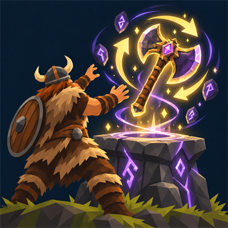

# EpicLoot Auto Augment

Skip the repetitive clicking at the enchanting table. Choose an effect and let Auto Augment keep trying until it appears or you run out of materials.

- Optionally set a **minimum value** for your chosen effect.
- Uses EpicLoot's normal costs and chances.
- Stops on a match and leaves the usual choice window open for you to pick the effect.
- Press **Stop** at any time.
- Works with **EpicLoot Container Access** for materials in nearby storage.

## How to use

Select an item and slot in the Augment tab, click your desired effect under **Available Effects**, and press **Auto Augment**. Enable **Minimum value** if you want a specific roll or better.

When a match appears, choose it yourself. **Esc keeps the old effect**, just like normal EpicLoot.

## Install

**Client only** — the server and other players do not need this mod.

Requires **EpicLoot 0.15.5**, **BepInExPack Valheim** and **Jotunn 2.30.2 or newer**. Install through your mod manager, or extract the ZIP's `BepInEx` folder into your profile.

[Source and issues](https://github.com/NorskIT/EpicLootAutoAugment)
